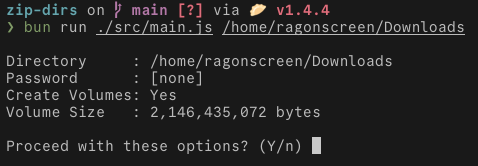
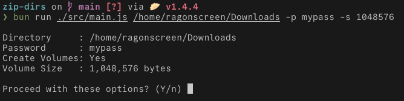
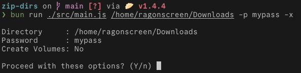
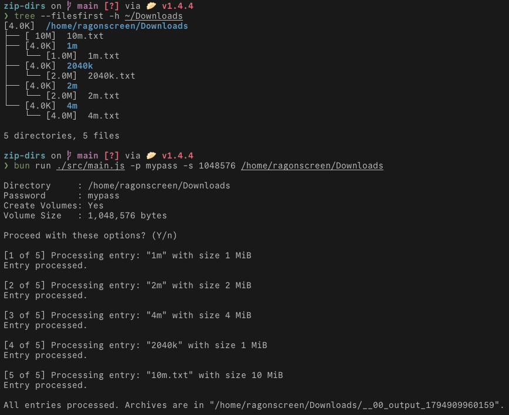
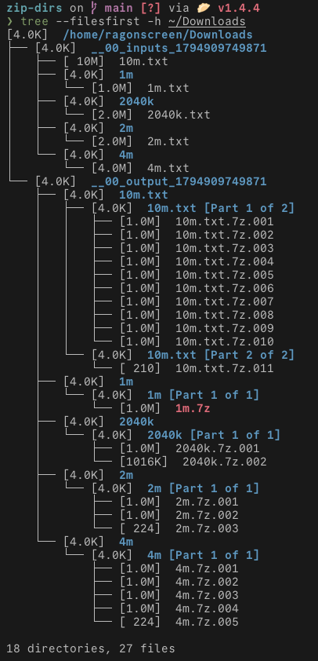

# zipdirs

Create separate archives from the contents of a directory with a predefined
volume size.

## Dependencies

The JavaScript runtime [bun.js](https://bun.com/docs/installation) is required
to run this script.

[`7z`](https://www.7-zip.org/) - Must be installed and added to your path. The
installed version must support the following flags: `-t`, `-bs`, and `-mx`.
Additionally, the flags `-mhe` and `-p` are required for password protected
archives, and `-v` for volume creation. Running the `7z` command should return
something similar:

```
$ 7z

7-Zip 23.01 (x64) : Copyright (c) 1999-2023 Igor Pavlov : 2023-06-20
 64-bit locale=en_US.UTF-8 Threads:6 OPEN_MAX:1024

Usage: 7z <command> [<switches>...] <archive_name> [<file_names>...] [@listfile]

...
```

## Installation

Download the singular file `src/main.js` which contains the entire script, and
preferably save it as `zipdirs.js` (or get the entire project folder using
`git clone`).

## Usage

### Basic Usage

```sh
bun run zipdirs.js <PATH_TO_DIR>
```

This will create new archives from the contents of the `<PATH_TO_DIR>`
directory.

It is recommended to create a wrapper script for `bash` (or `zsh`, etc.) which
runs the `zipdirs.js` file like so:

File: `~/.bashrc`

```sh
zipdirs() {
        bun run "/home/<USER>/Downloads/zipdirs.js"
}
```

Replace `"/home/<USER>/Downloads/zipdirs.js"` with the path you downloaded the
folder/file to.

### Options

- `-h`, `--help` - Display help text
- `-p`, `--password` `PASS` - Set archive password to `PASS` (default: none)
- `-s`, `--volume-size-bytes` `SIZE` - Set size of each volume to `SIZE` in
  bytes (default: 2'146'435'072 = 2 GiB - 1 MiB)
- `-x`, `--no-volumes` - Do not create volumes (default: false)
- `-y`, `--yes` - Proceed without confirmation (default: false)

### Examples

Basic usage:



Archive password and volume size:



No volumes:



Running the second command above, results in the following:





---
